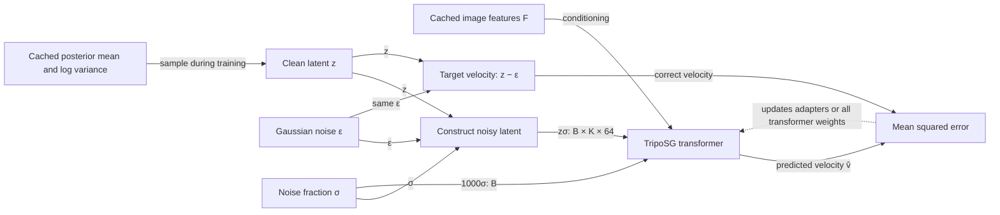
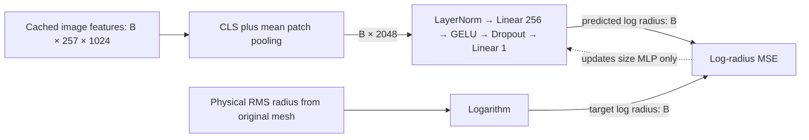
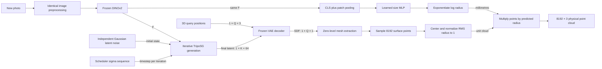

# Food-specific TripoSG: shape adaptation and physical size

This document explains the implemented experiment. It is a proposed adaptation,
not an architecture published by TripoSG's authors. The [interactive HTML](triposg_architecture.html)
shows the same blocks with selectable training modes and tensor dimensions.
The [run guide](../baselines/generators/triposg/finetune/README.md) contains commands.

## Overview

A photo does not uniquely determine a food object's hidden surface or physical
size. We reuse a pretrained 3D generator for the shape prior, adapt that prior to
food, and learn physical scale as a separate supervised task. The final output is
exactly 8,192 surface points with coordinates in millimetres.

There are two training phases, not one joint optimization:

1. **Shape training:** a frozen VAE encodes normalized ground-truth surfaces.
   The transformer learns to recover their latent distribution from noise while
   conditioned on the corresponding photo. LoRA updates attention adapters; full
   fine-tuning updates every transformer parameter.
2. **Size training:** a small MLP predicts log RMS radius from frozen image features.
   It uses the original metric mesh for its label. It never needs the transformer.

At inference the learned shape model and size MLP run on the same photo. The
generated cloud is centered, normalized to RMS radius one, then multiplied by the
predicted physical radius. Ground-truth geometry is never an inference input.

## Key concepts and tensor notation

`B` is microbatch size. `N` is the number of input surface samples (default 32,768).
`K` is the latent-token count (default 2,048). `Q` is a chunk of decoder query positions.

| Symbol | Shape | Meaning |
|---|---|---|
| RGB pixels | `B × 3 × 224 × 224` | Normalized DINOv2 input |
| `F` | `B × 257 × 1024` | Image features: one CLS token and 256 patch tokens |
| Surface | `B × N × 6` | XYZ followed by outward face-normal XYZ |
| Posterior mean/log variance | each `B × K × 64` | Frozen VAE's distribution over shape codes |
| `z` | `B × K × 64` | Clean target shape latent |
| `ε` | `B × K × 64` | Independent standard Gaussian noise |
| `σ` | `B` | Noise fraction, between zero and one |
| Model timestep | `B` | `1000σ` for the released scheduler |
| `zσ` | `B × K × 64` | Noisy latent, not a point cloud |
| `v̂` | `B × K × 64` | Predicted latent velocity |
| Pooled feature | `B × 2048` | Concatenated CLS token and mean patch token |
| Log radius | `B` | Logarithm of physical RMS radius in mm |
| Query positions | `B × Q × 3` | Positions where the decoder evaluates the SDF |
| SDF values | `B × Q × 1` | Signed-distance predictions |
| Mesh | variable `V × 3`, `T × 3` | Vertices and triangle indices |
| Final cloud | `B × 8192 × 3` | Physical coordinates in millimetres |

Frozen means parameters do not change. It does not mean the module produces no
output. Frozen encoder computations are cached and removed from the training GPU.
During LoRA training, gradients still propagate through transformer operations to
reach the adapters. Do not wrap the transformer forward in `torch.no_grad()`.

## Before training: build the cache

`prepare.py manifest` discovers image/mesh pairs and creates a grouped split.
Exact duplicate mesh hashes cannot cross the split. An optional ID-to-object-group
file joins multiple scans of the same physical item. Unknown near-duplicates still
need a data audit. The manifest stores relative paths and file hashes, so paths can
move to an authorized cloud machine without changing IDs or split membership.

`prepare.py encode` runs DINOv2 and the VAE separately. It writes image features,
posterior mean/log variance, and physical radius to one NPZ per object. It writes a
completion marker only after every object is complete. No preprocessing runs on
validation labels jointly with training statistics.

### Image path

1. `prepared_image` opens the photo. RGBA input is cropped to its alpha support
   and composited over white. RGB input keeps its full field of view. Both receive
   square white padding. No segmentation model runs implicitly.
2. The checkpoint's image processor resizes the shorter edge to 256, center-crops
   to 224, rescales pixel values, and applies ImageNet normalization.
3. Frozen DINOv2-Large uses 14-pixel patches: `224/14 = 16`, giving 256 patch
   tokens plus one CLS token. Its last hidden state has width 1,024.

The same `prepared_image` function runs during prediction. A training-only crop or
mask would create an avoidable distribution shift. Extra image views and
augmentations require more cached features; the present cache holds one view.

### Mesh path and physical label

`normalized_surface` samples points uniformly by triangle area and gathers their
face normals. It measures RMS radius about their surface centroid:

`r_gt = sqrt(mean_i ||p_i − mean(p)||²) × mesh_unit_mm`.

That label is measured **before geometry normalization**. Verify coordinate units
against the dataset protocol and `gt.json:bbox_mm`. The multiplier is explicit.
The MLP does not read volume, reference-object metadata, or category labels.

For the VAE, the geometry is centered and optionally rotated to a proper PCA frame.
The rotation determinant is positive, so no reflection is introduced. The maximum
absolute vertex coordinate is scaled to 0.95. Positions therefore fit the decoder
query domain near `[-1,1]`. Normals rotate with positions but are not scaled.

This is **not RMS normalization**. An RMS-normalized shape can extend beyond the
VAE's supported query region. RMS normalization occurs only on the sampled output
cloud immediately before applying physical scale.

PCA removes the arbitrary scan pose in this dataset but can be unstable for
symmetric foods. It also changes the pretrained generator's usual pose convention.
Mesh pose can be retained with `--pose mesh`. Neither path recovers camera pose.

### VAE contract

The VAE receives XYZ plus normal features, not raw triangle arrays. Its encoder
selects query surface points using FPS and compresses them into a Gaussian latent
posterior. The cache preserves both mean and log variance. Training can sample
`z = mean + exp(0.5 logvar) × η`. Validation uses the mean for repeatability.

The upstream inference release comments out its `torch_cluster.fps` import.
`prepare.py` explicitly supplies it at runtime; the upstream checkout is not edited.
Validate reconstructed ground-truth shapes through the frozen decoder before a
long run. A frozen VAE cannot represent details its latent space discards.

## Phase 1: train shape adapters or all transformer weights

### Noise, time, and the released scheduler

The code uses the actual released scheduler convention:

`zσ = (1 − σ) z + σ ε`, with `σ=1` pure noise and `σ=0` clean shape.

The transformer receives `1000σ`, not the inverse clean fraction. Its scheduler
updates `z_next = z_current + (σ − σ_next) v̂`. Therefore the target velocity is
`z − ε`. The signs of the target and solver update must agree.

Earlier conversation diagrams used `t=1−σ`, a clean-fraction convention. That
notation describes the same interpolation but is not the tensor passed into the
released transformer. Do not copy the old `t` labels into implementation.

Uniform sigma sampling is the default. Logit-normal sampling is an optional
controlled experiment. Both preserve the same noise endpoint and timestep units.
Condition dropout replaces the entire image feature sequence with zeros for 10%
of training examples, matching the pipeline's unconditional feature convention.

### Transformer block and LoRA ownership

The released transformer projects the 64-channel latents to internal width 2,048.
It embeds the timestep, prepends a time token, and processes a stack of 21 blocks.
Image tokens condition cross-attention. The output projects back to 64 channels
per latent token. Its output is velocity, not vertices or SDF values.

LoRA replaces a selected linear operation `Wx` with `Wx + (α/r) BAx`. `W` stays
frozen. Low-rank matrices `A` and `B` are trainable. PEFT attaches adapters to
`to_q`, `to_k`, `to_v`, and `to_out.0` in self- and cross-attention. The first
adapter update preserves the pretrained function through PEFT's zero-output initialization.

| Component | LoRA mode | Full mode |
|---|---|---|
| DINOv2 | Frozen, cached | Frozen, cached |
| VAE encoder and decoder | Frozen | Frozen |
| Transformer original weights | Frozen | All trainable |
| Attention LoRA matrices | Trainable | Not installed |
| Size MLP | Separate phase | Separate phase |

Full mode includes input/output projections, time embeddings, attention, MLPs,
normalization and skip projections. It does not mean retraining the entire system.

### What Lightning owns

`FoodAdaptation.training_step` computes a scalar flow loss. It returns that scalar
to `lightning.Trainer`. Automatic optimization handles backward passes, gradient
accumulation, mixed-precision scaling, clipping, and optimizer steps.
`configure_optimizers` declares AdamW and a warmup/cosine scheduler. It does not
step either optimizer or scheduler manually.

`validation_step` uses fixed per-batch noise and sigma draws, no condition dropout,
and posterior means. `ModelCheckpoint` selects minimum validation latent MSE.
`EarlyStopping` monitors the same value. `CSVLogger` records scalar metrics.
`Trainer.fit(..., ckpt_path=...)` restores training state. A compatibility hook
rejects mismatched cache hashes, configuration, or phase.

Gradient checkpointing is a separate transformer flag: it recomputes activations
during backward to reduce memory. Lightning checkpoint files save training state.
These are different meanings of “checkpoint”.

The model has long skip connections, so activation recomputation cannot eliminate
all stored tensors. The memory probe measures one effective optimizer batch;
it does not predict the separate VAE-encoding or mesh-generation memory peak.

## Phase 2: train physical RMS radius

Pooling concatenates the global token with the mean of the 256 patch tokens.
The MLP normalizes these 2,048 features and uses a 256-unit hidden layer. Its final
bias starts at the mean training log radius. The validation labels never initialize
the network. This model has no category lookup or explicit size-cluster selector.

Its default loss is MSE in log millimetres. Exponentiation produces a positive radius.
`exp(predicted log radius)` is not automatically the posterior mean radius and
does not guarantee the best squared Chamfer score. Linear-radius MSE is logged
as a diagnostic. `configs/size_radius_mse.json` provides a controlled alternative:
keep the same head, split, and settings, but minimize physical radius MSE divided
by the fixed unit factor `40²`. Compare final metric CD and errors across size
ranges; the raw values of the two losses are not comparable. Neither recipe has
been trained yet. Multimodal scale and uncertainty remain future experiments.

## Inference: combine the two trained artifacts

Generation starts with an independent standard Gaussian tensor. Image features
never generate or modify that initial noise. At each step the transformer receives
the current latent, scheduler time, and image conditioning. The scheduler updates
the latent and sends it into the next step. Fifty iterations is the initial setting.

The pipeline uses classifier-free guidance: it predicts conditioned and zero-image
velocities, then combines them with guidance scale 7. Internally this doubles the
transformer batch when enabled. This is inference-time compute, not an additional
learned module. The same image encoder features are separately pooled for size.

The frozen VAE maps the final latent and queried XYZ positions to an implicit SDF.
Hierarchical extraction evaluates enough query positions to recover a zero-level
surface. The mesh may have a variable number of vertices and triangles. Uniform
area sampling produces exactly 8,192 points, independent of triangle count.

Finally, `metric_points` subtracts the surface centroid and divides by RMS radius.
It multiplies each coordinate by `exp(size_head(F))`:

`P_mm = predicted_radius_mm × (P − mean(P)) / RMSRadius(P)`.

No ground-truth radius, pose, mesh, or validation label enters prediction.
The `.npz` saves unit and physical clouds for diagnostics. The existing `geom.pack`
writes `geometry/{sample_id}.ply` inside the ZIP and enforces the point count.

## Where things live

| File | Responsibility |
|---|---|
| `finetune/common.py` | Upstream pin, preprocessing, normalization, LoRA installation/export, size MLP, flow equation |
| `finetune/prepare.py` | Paired-data manifest and frozen encoder cache |
| `finetune/train.py` | `FoodAdaptation` LightningModule and Trainer configuration |
| `finetune/configs/` | LoRA, T4, full-transformer, and size starting recipes |
| `finetune/predict.py` | Frozen/LoRA/full shape inference plus size and ZIP export |
| `finetune/evaluate.py` | Rigid-only local metric and oracle-size diagnostics |
| `finetune/test_contracts.py` | Offline numerical and Lightning integration contracts |

All `finetune/` paths are under `baselines/generators/triposg/`.

## Recommended starting point and alternatives

Use cached encoders and Lightning automatic optimization. Start with rank-16 LoRA
on a 24 GB GPU target: LR `5e-5`, effective batch 16, bf16, 20 epochs maximum,
5% warmup, weight decay 0.01, condition dropout 0.1, and early-stopping patience 5.
The T4 recipe uses fp16 and rank 8. The full recipe targets an A100 80 GB with LR
`5e-6` and 10 epochs maximum. Size uses LR `3e-4`, batch 32, and patience 10.
These are starting hypotheses, not measured best settings or memory guarantees.

The unchanged generator with the SAME learned size head is the necessary baseline.
Compare LoRA next. Spend on full tuning only if the comparison justifies it.
Report metric CD, oracle-size CD, failure count, and per-object radius error on
identical held-out IDs, then repeat promising recipes with a second seed.

We chose a cache boundary over jointly executing the frozen encoders every batch.
This reduces training GPU memory and gives both tasks the same feature contract.
We accept less online augmentation in exchange. A joint differentiable geometry
loss would align more closely with the challenge, but differentiating through
sampling/mesh extraction and unrolled generation adds a different research problem.

We chose Lightning Trainer over a handwritten optimization loop. Lightning hides
the optimizer lifecycle and resume machinery; the custom code exposes only the
flow objective and dataset contracts. Hugging Face Trainer is also viable but
requires adapting non-language model outputs and export behavior. Fabric alone
would leave the loop ownership with us, which is unnecessary here.

## Gotchas and unresolved evidence

- The runtime has not trained the 1.5B checkpoint. Tiny offline tests establish
  API and numerical contracts, not data quality, VRAM, convergence, or leaderboard gains.
- VAE input normalization and pose are adaptation choices. Test frozen VAE
  reconstruction and canonical-pose stability before interpreting training losses.
- The new grouped holdout differs from historic Atlas scores. Never compare
  their aggregate numbers without re-scoring the same objects.
- The evaluator is a reproducible local diagnostic, not a certified copy of the
  challenge grader. It never fits scale, and it rejects missing validation IDs.
- A point-cloud ensemble's RMS radius need not describe a real object's size.
  This model uses a dedicated physical-label head instead of borrowing that radius.
- Resume `.ckpt` files include frozen base weights. LoRA inference `best.pt`
  exports contain only adapters. Keep both when using disposable cloud sessions.

## Source references

- [TripoSG paper, Figure 2 and model description](https://arxiv.org/html/2502.06608v1)
- [Released transformer and attention blocks](https://github.com/VAST-AI-Research/TripoSG/blob/fc5c40990181e2a756c4e0b1c2f4d6b5202faf8c/triposg/models/transformers/triposg_transformer.py)
- [Released VAE encoder and decoder](https://github.com/VAST-AI-Research/TripoSG/blob/fc5c40990181e2a756c4e0b1c2f4d6b5202faf8c/triposg/models/autoencoders/autoencoder_kl_triposg.py)
- [Released scheduler: scale_noise and step](https://github.com/VAST-AI-Research/TripoSG/blob/fc5c40990181e2a756c4e0b1c2f4d6b5202faf8c/triposg/schedulers/scheduling_rectified_flow.py)
- [Checkpoint configuration files](https://huggingface.co/VAST-AI/TripoSG/tree/main)
- [Lightning Trainer](https://lightning.ai/docs/pytorch/stable/common/trainer.html)
- [LightningModule](https://lightning.ai/docs/pytorch/stable/common/lightning_module.html)
- [Checkpoint resume](https://lightning.ai/docs/pytorch/stable/common/checkpointing_basic.html)
- [pstack how: walkthrough structure](https://github.com/cursor/plugins/blob/main/pstack/skills/how/SKILL.md)
- [pstack architect: usage, ownership, trade-offs](https://github.com/cursor/plugins/blob/main/pstack/skills/architect/SKILL.md)

The writing follows the requested pstack explanation style: overview, named
concepts, traced data flow, ownership, code locations, and gotchas. No claim is
made that pstack's multi-agent workflows were run.
